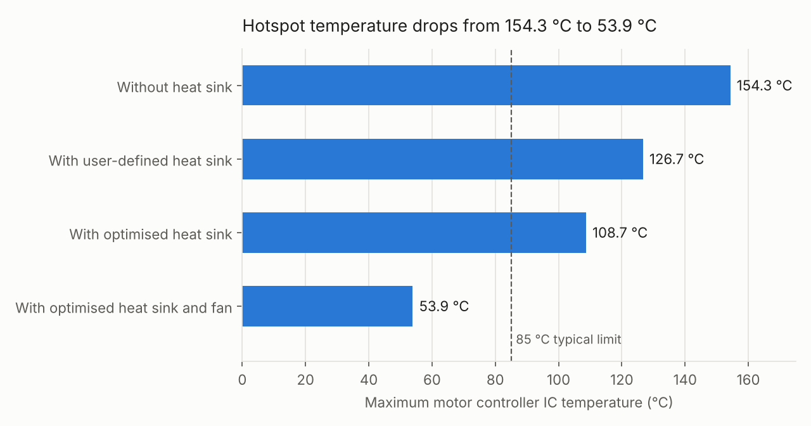
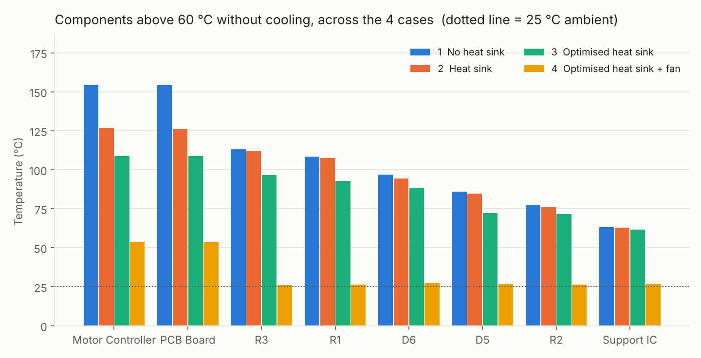
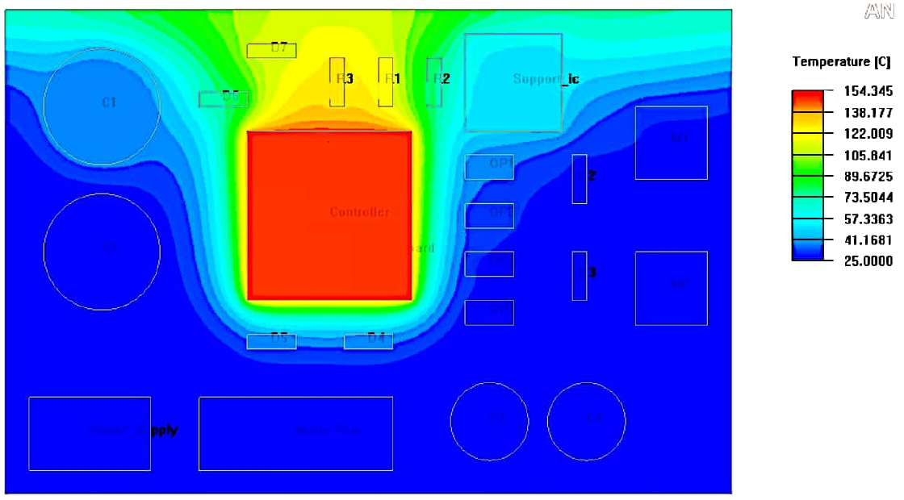
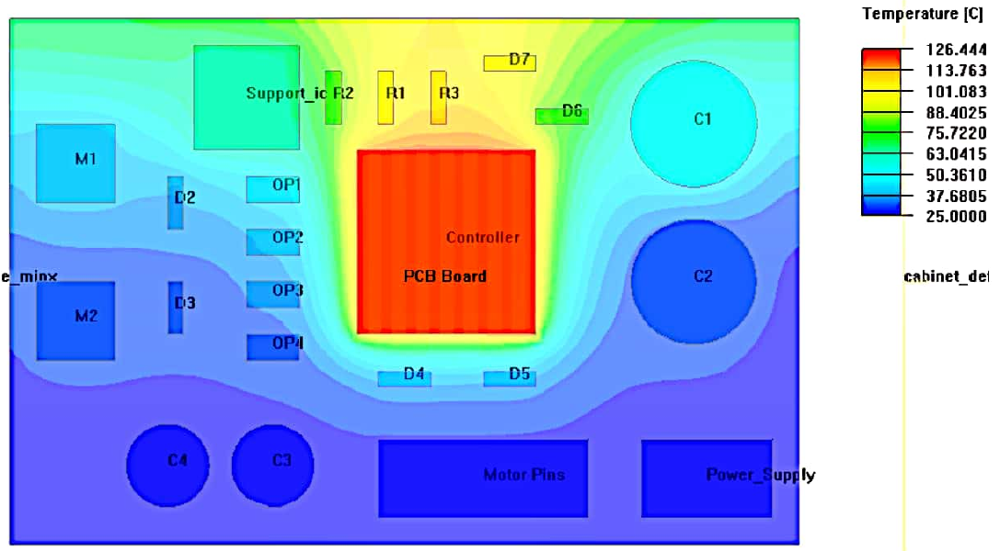
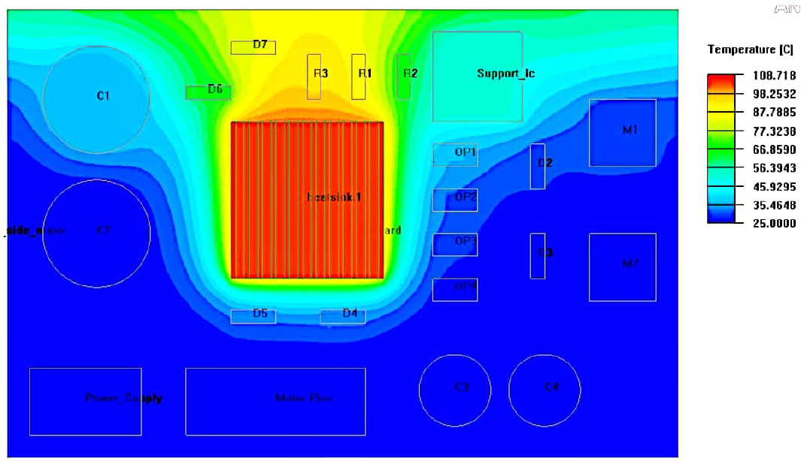
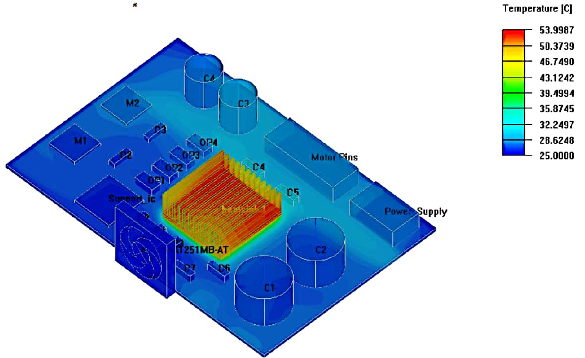
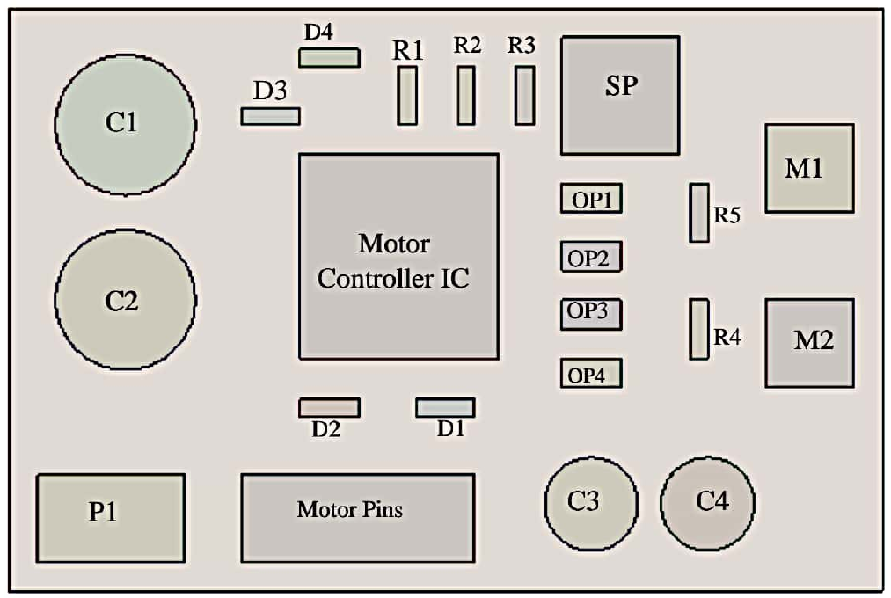

# Thermal Optimisation of an H-Bridge Motor Controller (Ansys Icepak)

I did this project for my thesis *"Optimum Design of Electronic Cooling"*. The question behind it is simple: **how hot does the controller IC on an EV motor controller board get, and how much can I cool it with a heat sink, an optimised heat sink and a fan?**

I modelled a simplified H-bridge motor controller board in **Ansys Icepak**, ran a CFD thermal simulation and then tried three ways to bring the hotspot temperature down. With all three steps together, the maximum temperature dropped from **154.3 °C to 53.9 °C**.

Live dashboard: https://sajin-saji.github.io/thermal-optimisation-h-bridge/dashboard/



## Results

| Case | Setup | Max IC temp (°C) | Drop vs case 1 | Rise above ambient |
|---|---|---|---|---|
| 1 | Without heat sink | **154.3** | – | +129.3 K |
| 2 | With user-defined heat sink | **126.7** | −27.6 °C (17.9 %) | +101.7 K |
| 3 | With optimised heat sink | **108.7** | −45.6 °C (29.6 %) | +83.7 K |
| 4 | With optimised heat sink and fan | **53.9** | −100.4 °C (65.1 %) | +28.9 K |

Cases 1 to 3 are natural convection with laminar flow. Case 4 is forced convection with a fan, so the flow is turbulent (k-ε model).

What I take away from it:

- **The heat sink alone helps, but not enough.** 154 °C → 127 °C. Still far above the ~85 °C that is usually seen as the limit.
- **Optimising the heat sink gives another 18 °C for free.** Same material and same footprint, just a better fin count, fin thickness and base height. 127 °C → 109 °C.
- **Airflow is the big lever.** A small 1000 rpm fan blowing parallel to the fins brings the IC to 54 °C, and almost every other component ends up close to ambient (26 to 32 °C).
- **Placement matters.** The hottest IC sits in the middle of the board so the heat can spread in all directions. The resistors and diodes right next to it (R1, R3, D6) are the next hottest parts.



### Temperature fields from Icepak

| Case 1: no heat sink (154.3 °C) | Case 2: heat sink (126.7 °C) |
|---|---|
|  |  |
| **Case 3: optimised heat sink (108.7 °C)** | **Case 4: optimised heat sink + fan (53.9 °C)** |
|  |  |

## The model



The board is a simplified motor controller: user input → motor controller IC → PWM signals → optocouplers → MOSFETs → motor output. Component sizes follow standard package sizes that you can buy.

| Item | Material | Qty | Heat output (W) |
|---|---|---|---|
| Motor controller IC | Silicon | 1 | 20 |
| Electrolytic capacitor | Ceramic | 4 | 1 |
| MOSFET | Silicon | 2 | 2 |
| Diode | Silicon | 4 | 0 |
| Optocoupler | Silicon | 4 | 0 |
| Resistor | Ceramic | 5 | 0 |
| PCB | FR4 | 1 | 0 |

**Simulation setup**

- Mesher HD in Icepak, multi-level mesh (level 1 for the PCB up to level 4 for small parts), 644,499 elements
- Natural convection with the Boussinesq approximation, ambient 25 °C, 101,325 Pa, radiation off
- Convergence: flow 1e-3, energy 1e-7. The model converged after about 175 of 200 iterations
- Board inside a cabinet with two openings (cases 1 to 3), and a fan + grille instead of the openings in case 4

## Heat sink optimisation

I linked the Icepak model to **Response Surface Optimisation** in Ansys Workbench and made three heat sink dimensions into parameters:

| Parameter | Start value | Range |
|---|---|---|
| Number of fins `N` | 8 | 8 to 14 |
| Fin thickness `th` | 2 mm | 0.5 to 2 mm |
| Base height `bh` | 1.5 mm | 0.5 to 2 mm |

The overall height stayed fixed at 11 mm (aluminium) to keep the computing time down. Workbench created **35 design points** (for each fin count: the centre point and the 4 corners of the `th`/`bh` range). The objectives were minimum maximum temperature, minimum heat sink mass and minimum thermal resistance. `src/generate_doe.py` rebuilds that table.

## Repository structure

```
├── README.md
├── dashboard/
│   └── index.html                 interactive results page (GitHub Pages)
├── data/
│   ├── case_summary.csv           max IC temperature for the 4 cases
│   ├── component_temperatures.csv every component in every case (thesis tables 5.1–5.4)
│   ├── component_setup.csv        materials and heat loads
│   ├── heatsink_parameters.csv    optimisation parameters and bounds
│   ├── doe_design_points.csv      the 35 design points
│   └── simulation_settings.csv    solver and mesh settings
├── docs/
│   ├── thesis_optimum_design_electronic_cooling.pdf
│   ├── methodology.md             short version of the method
│   └── figures/                   geometry and Icepak contour plots from the thesis
├── results/                       charts made by src/analyse_results.py
├── src/
│   ├── analyse_results.py         reductions per case + charts
│   └── generate_doe.py            rebuilds the DOE table
└── requirements.txt
```

## How to run it

```bash
pip install -r requirements.txt
python src/generate_doe.py
python src/analyse_results.py
```

The scripts only use the CSV files. You don't need Ansys to run them. The Icepak project files are not in this repo because they are very large.

## Publish the dashboard

Settings → Pages → Source: *Deploy from a branch* → Branch `main`, folder `/ (root)` → Save. After a minute the dashboard is at `https://<your-username>.github.io/<repo-name>/dashboard/`.

## Limitations and notes

I want to be honest about what this model can and cannot show:

- **It is a simulation only.** I did not measure a real board, so the absolute temperatures are not validated against tests.
- **The board is simplified.** No copper layers, no thermal vias, no traces. Real PCBs spread heat better, so the real temperatures would likely be lower.
- **Small mismatches in the thesis text.** Table 3.1 gives the controller IC 20 W, while one sentence in section 5.3 says 30 W. The iteration count is given as 200 in the setup and 1000 in the discussion. Table 4.4 lists "turbulent: on" while the case descriptions say laminar for cases 1 to 3. The values in this repo follow the tables.
- **The final optimised dimensions** (`N`, `th`, `bh`) are not written out as numbers in the thesis, so I only report the resulting temperature.
- Natural convection with the board in a closed cabinet is a conservative case. That is why the fan has such a big effect.

## Tools

Ansys Icepak · Ansys Workbench (Response Surface Optimisation) · Python (pandas, matplotlib) · HTML/CSS/JS

**Keywords:** thermal management, electronics cooling, CFD, heat sink optimisation, H-bridge, EV motor controller
